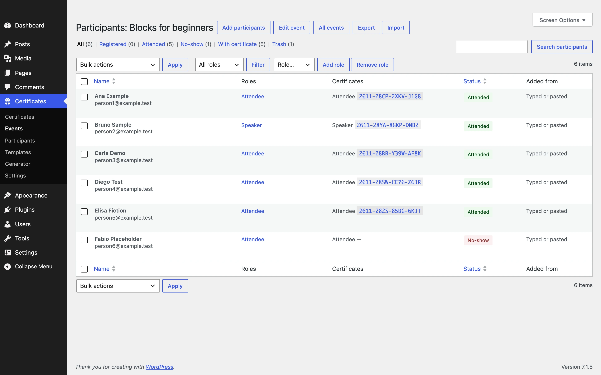

## Events

The list of events can be filtered by month and year, like the posts list.

An event has a name, a start and an end, a place (or a venue and a city), a community name, speakers, a link and the **workload in hours** (a number for all, or one per role). It can also have its own **logo** and **signature picture**, which win over the template's and the Settings'.

## Participants

Each participant has a name, an e-mail (optional), a WordPress.org username (optional), a **status** (registered, attended, no-show) and one or more **roles** (attendee, speaker, organizer, volunteer).

**Certificates › Participants** lists everyone from every event in one table, with an avatar, their event, roles, certificates and status, a search, the status views, and filters by event and by role. The same actions as an event's own list (mark attended, no-show or registered, issue certificates, Trash) work on what you tick. To mark who came, issue or trash, open the person's event from the row.

Ways to add them:

- Type or paste names, one per line. A line can be `Name, e-mail, role`.
- Upload a **CSV** (the first row is the column names) or the attendee export of Meetup.
- Bring them from **GatherPress** or **CampTix** if the plugin is active.

Adding someone who is already there updates them; nobody is added twice.

## Attendance and certificates

Mark people as attended, then issue. A row with a certificate has **Download current**. Only people who attended get a certificate.

## The Trash

Removing a participant moves them to the event's **Trash**: they leave the list and the counts and get nothing issued while they are there. From the Trash you can **Restore**, **Delete permanently** or **Empty the Trash**. Certificates already issued stay valid either way.
