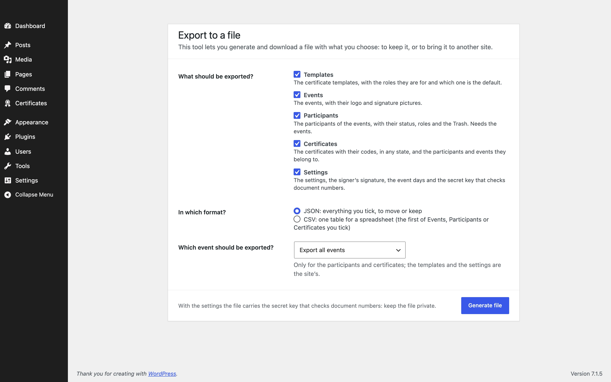

In **Standalone**, the **Export** and **Import** buttons are next to the title of the Certificates, Events, Templates, Participants and Settings screens. Each opens its screen with that part ticked.

> With **GatherPress** or **CampTix** active, export and import of lists are **off** (events and people belong to them). One template can still be exported and imported from the template editor: [Template files and blocks](../template-files/).

## Export

Tick what to include and choose the format:

- **JSON**: everything you tick, to move to another site or keep.
- **CSV**: one table (events, participants or certificates) for a spreadsheet.

### Fonts and pictures of the templates

When a template uses a font installed in WordPress (Inter, a brand font) or a picture chosen from the Media Library, a box **Include the fonts and pictures the templates use** appears, **ticked** (the screen lists what it found). Then the file is a **ZIP** with the JSON and the folders `fonts` and `images`, so the templates arrive with what they need. Without it the file is the same JSON as always, and a template whose font is missing on the other site uses the shipped font that stands in for it. The box needs the PHP ZipArchive extension. Check that the licenses of the fonts let you share them.

Participants and certificates come with the events they belong to. With the settings the file also carries the **secret key** that checks document numbers: **keep the file private**.

## Import

A wizard in four steps: **upload the file**, **review** what it has (for a CSV, **map the columns** to fields), **import** with a progress bar, **done** with the counts and a log.

- A certificate is found by its **code** and is **never written over**; a code that is already here with other content is reported.
- Importing the same file twice changes nothing.
- "Update existing" rewrites templates, events and participants that are already here.
- A CSV can bring events or participants. Certificates travel only in the JSON file.
- A **ZIP** (the one made with the fonts and pictures) is imported like the JSON. The review has a box **Install the fonts and pictures of the templates**, ticked: fonts go to the **Font Library** and pictures to the **Media Library**, and the imported templates point to them. A font or picture that is already here is not made again. Installing fonts needs the permission to edit the theme and pictures the permission to upload files; without them the templates come in and the fonts and pictures are left out, with a note. Only fonts (`ttf`, `otf`, `woff`, `woff2`) and pictures (`png`, `jpg`, `gif`, `webp`) the file lists are taken, each checked (size, SHA-256 and the kind of file); an SVG is never taken.

Everything in a file is cleaned again on the way in; the file is never trusted.

## Pictures

Logos and signature pictures are files of the Media Library. An export that includes them is a ZIP: each picture is a file in `images/` and the
JSON only refers to it (`picture:<sha256>`), so nothing is stored as text inside the data. On import each file becomes one attachment (the same
file twice is one attachment) and the events, certificates and signature use it. A plain JSON export has those places empty, and a file made by an
older version with the pictures inside the JSON brings no pictures: convert it first with `bin/move-pictures-to-media.php json old.json new.zip`.
Deleting or replacing an attachment in the Media Library changes the certificates that use it.
