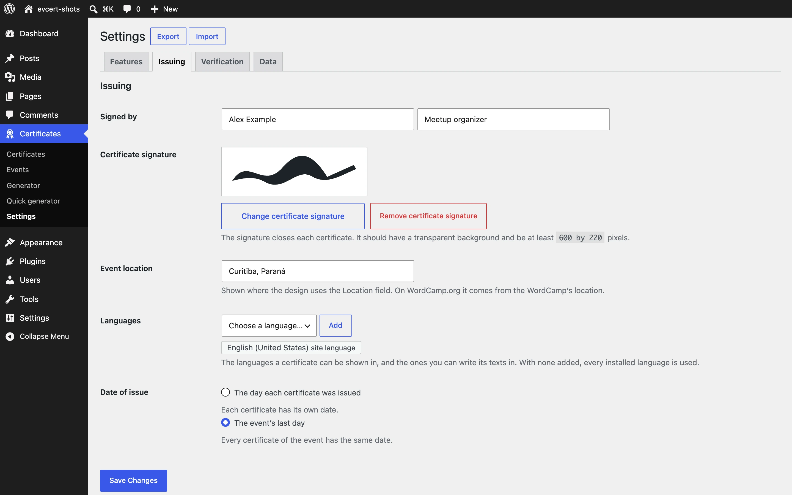

The settings are one **Certificates** screen with tabs, and where it sits depends on your [case](../../scenarios/standalone/):

| Case | Where |
|---|---|
| Standalone (and both together) | **Certificates › Settings** |
| GatherPress | **GatherPress › Settings › Certificates** |
| WordCamp.org (CampTix) | **Tickets › Setup › Certificates** |

The tabs are the same everywhere:

- **Features**: turn on **Verification** (a code and a QR on each certificate).
- **Issuing**: **Signed by** (name and role) and the **Certificate signature** (choose a picture or an SVG; see below), the event location, the languages the date of issue (the day each was issued, or the event's last day) and the **Certificate colors**: **Light only** (the default) or **Light and dark**, which also gives the page that checks a certificate a dark version with a button, and the template editor the dark colors. The PDF is always light.
- **Verification**: the check page and how the participant proves who they are.
- **Declaration**: the extra page for attendees' declaration, with CampTix ([Declaration page](../declaration-page/)).
- **Data**: whether the plugin's data is deleted when it is uninstalled.
- **Tools**: make again what the plugin makes once (the generator page, the check page, the "Get my certificate" page, the starter templates) and repair the tables, the addresses and the caches. A page that is there goes to the Trash first; a template that is there stays. The same actions are in WP-CLI: see [Command line](../../reference/cli/).

## The signature

**Choose a certificate signature** opens the media modal, as the Site Icon does: **Upload files** or pick from the **Media Library** (PNG, JPEG, GIF or WebP, ideally with a transparent background and at least 600 by 220 pixels), or the **SVG** tab: paste the code of an SVG (or drop an `.svg` file on the window) and it becomes a list of paths you can recolor and reorder. An SVG file is never uploaded: it is read in your browser and only its filled paths are kept. If you copied SVG code, a toast offers to paste it.

In Standalone the export and import of the settings is on the screen's title bar. With GatherPress or CampTix it is off.
