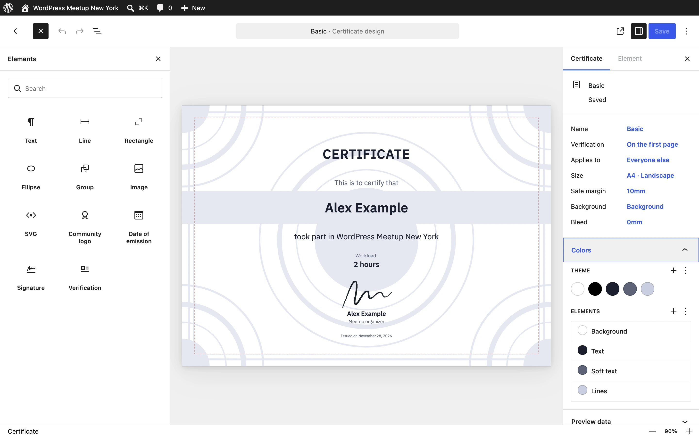

A **template** says how a certificate looks. **Certificates › Templates** lists them; one is the **default** and applies to everyone not covered by another. A new site starts with two: **Basic**, the default, and **Meetup**, which the Quick generator uses (the same layout with "WordPress Meetup" on the band). A template added with the form (from the Base design, a blank design or another template) opens in the editor; duplicating one from its row keeps you in the list.

## The editor

The editor shows the certificate page as you design it:

- **Elements**: text, shapes, images, an SVG, the **logo**, the **signature**, the **verification block** (QR code, code and a hint), the **date of emission** and more. Texts can use values such as the participant's name, the event, the date and the hours (write a value as `[[name]]` or `[[issued_date:long]]`, **bold** as `**bold**` and *italic* as `*italic*`). The date of emission shows the date in the format of Settings → General; edit it and write another format (`d/m/Y`, `j \d\e F \d\e Y`) to change it.
- **Selecting**: click an element (inside a group it selects the group; double-click goes down a level). Shift+click selects a range, Cmd/Ctrl+click adds or removes one, and dragging a box on the page selects what it touches. Cmd+A selects all (again: the group), Esc goes back up. With several selected, Delete, Cmd+D, the arrows and dragging act on all of them, and the bar over them groups them (Group, Row, Stack, Grid) or opens the Options menu. Cmd+C, Cmd+X and Cmd+V copy, cut and paste elements, also into another template.
- **Colors** (the Colors section of the sidebar, closed until you open it) hold the **Theme** and the colors the certificate uses. The **Theme** is the list of colors to pick from, and **Elements** the colors the certificate uses (Text, Background, brand, lines…). None of them is fixed: each can be renamed (in Show details) and removed, a new template starts with Base and Contrast in the Theme and Text and Background in Elements, and an empty one (Clear) starts with none. The **+** adds a color (Color 1, Color 2…) and opens its name. A certificate with no colors still works: text is black and the page white. By default a certificate is light, so each color is one circle and one value (the PDF is always light). With **Settings → Certificate colors → Light and dark**, each color shows two circles, Light and Dark; click it to choose its Light and its Dark value on two tabs, from the theme or any color, or Clear (a color may have no value). Dark values you gave a color are kept when you go back to light only. A color keeps the values you gave it, so changing the theme later changes nothing already set. Without a Dark value, the Light one is used in dark mode. With Light and dark, the moon button in the section header (and the one in the top bar) previews the certificate in dark mode. A pure white background is left unpainted in the PDF, so the paper shows through. **Preview data** is also a closed section: open it to change the sample values the editor shows.
- **Fonts**: the plugin ships only IBM Plex Sans and Instrument Serif. Any other font is installed in WordPress (Site Editor › Styles › Typography › Fonts) and shows in the **Font** list of a text. For the PDF to use it, install it as **TrueType, OpenType or WOFF** (the Upload tab): fonts from Google Fonts are WOFF2, which shows on the page and in the editor but not in the PDF (the list says what the PDF uses instead). A template that names a font the site does not have still works, with the shipped font that stands in for it.
- A **command palette** (<kbd>⌘K</kbd>) searches the editor's actions.

The **signature** element draws the Settings signature (a picture or an SVG) or the one the event brings.

## Roles

A template can be limited to roles (for example only *speaker*), so speakers get another look. The first template that applies wins, in the order of the list; the default is used for the rest.

## Moving a template

The editor can **export** a template as a file and **import** one. To move all your templates, events and certificates at once, use [Export and import](../export-and-import/).
