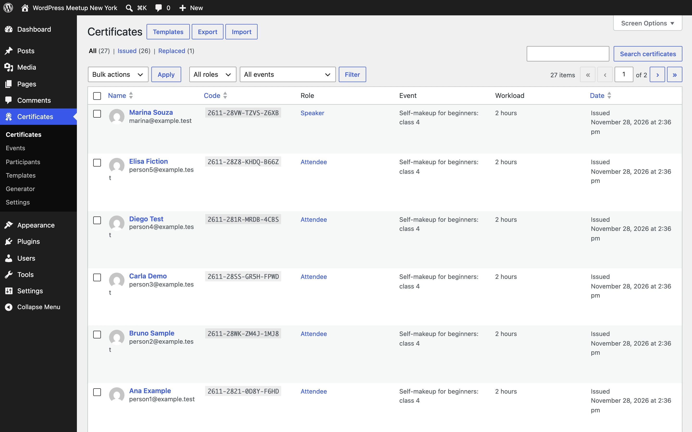

When **Verification** is on (Settings › Features), each certificate carries a **code** like `2611-ABCD-EFGH-JKLM` and a QR code. Anyone can type the code on the check page, or scan the QR, and sees whether it is on record.

## What the check says

- **Certificate on record**: the code exists. It says *on record*, not *authentic*: compare a printed copy with the page.
- **Replaced by a corrected certificate**: the old code links to the new one.
- **Revoked**: with the reason you gave.
- A certificate in the **Trash** is off the record: its code answers as if it did not exist.

## Correcting and revoking

**Correct and reissue** makes a new certificate and marks the old one replaced, so there are never two valid ones for the same person and role. **Revoke** is final and keeps saying so. Moving a certificate to the **Trash** is for undoing a mistake: it can be restored, unless a newer valid one was issued meanwhile.

## No verification

With Verification off, certificates carry no code or QR and cannot be checked; the list has no Code column and no Revoke.
