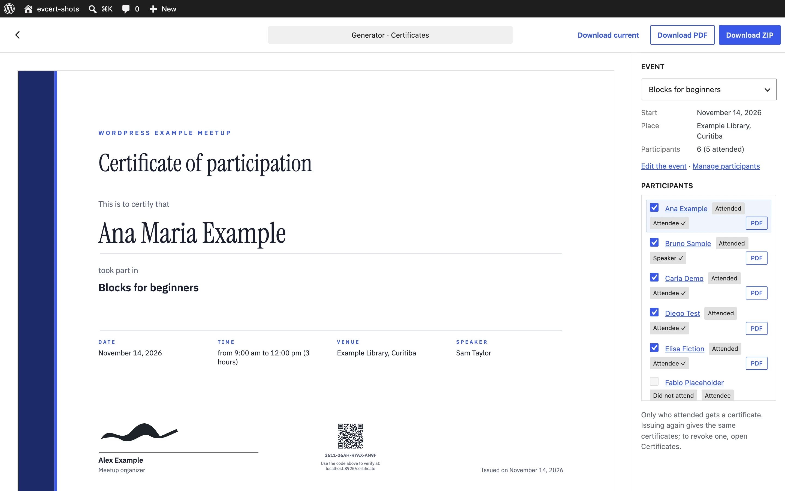

## 1. Add an event

Go to **Certificates › Events** and choose **Add event**. Give it a name and a start date; the rest is optional (place, workload in hours, speakers, a link).

## 2. Add the participants

Open the event's **Participants**. You can type or paste names (one per line), import a **CSV** or the attendee list exported from Meetup, or bring them from GatherPress or CampTix.

## 3. Mark who attended

Certificates are only for people who attended. Tick the people and use the bulk action **Mark as attended**.

## 4. Download

Open **Certificates › Generator**, choose the event, and click a name to preview the real certificate. Then use:

- **Download current**: the PDF of the person on the screen.
- **Download PDF**: one PDF with everyone who attended.
- **Download ZIP**: one PDF per person.

Issuing is done once: downloading again gives the same certificates, with the same codes.

## No records at all?

The **Quick generator** does the same without saving anything: fill in the event, paste the names, download.
