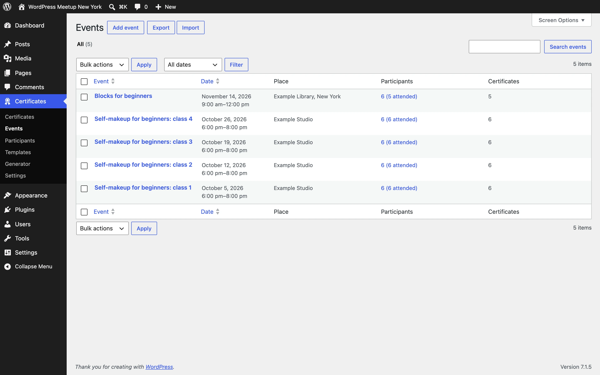

## The scenario

A self-makeup course for beginners has four classes. Students get a certificate for the course, and the instructor one that says they taught it.

## The steps

1. **Certificates › Events › Add event** for each class, with the date and the hours.
2. In **Add participants** paste the students, and the instructor with the role `Speaker` (`Marina Souza, marina@example.com, Speaker`). Tick that they attended and mark who did not.
3. In **Templates**, give each role its own template or text ([Roles and languages](../../guides/roles-and-languages/)), and pick a font from the WordPress Font Library.
4. In **Certificates › Generator** choose the class, preview each certificate and **Download ZIP**.
5. Turn on **Verification** (Settings › Features) if a code should be checkable; students can also ask for theirs on **Get my certificate**.

## What it does not do

It does not e-mail the certificates, and one PDF download holds up to 400.
