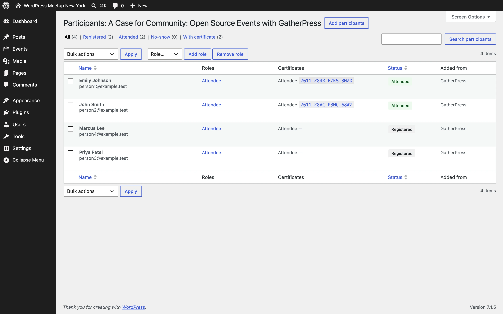

## The scenario

A community runs its meetups with GatherPress. People RSVP, the host checks them in at the door, and afterwards everyone who came should get a certificate.

## The steps

1. Run the event in GatherPress: RSVP and **check in** on the day.
2. In the **Events** list use the **Certificates** action of the event's row: those who RSVP'd as attending arrive as registered, those who checked in as attended, and the organizers with their role.
3. Open **Participants** and use **Issue certificates**.
4. If more people check in later, **Add participants › Sync with GatherPress** and **Issue the missing certificates**.

## What it does not do

It does not change anything in GatherPress, and it has no Generator of its own here ([GatherPress](../../scenarios/gatherpress/)).
