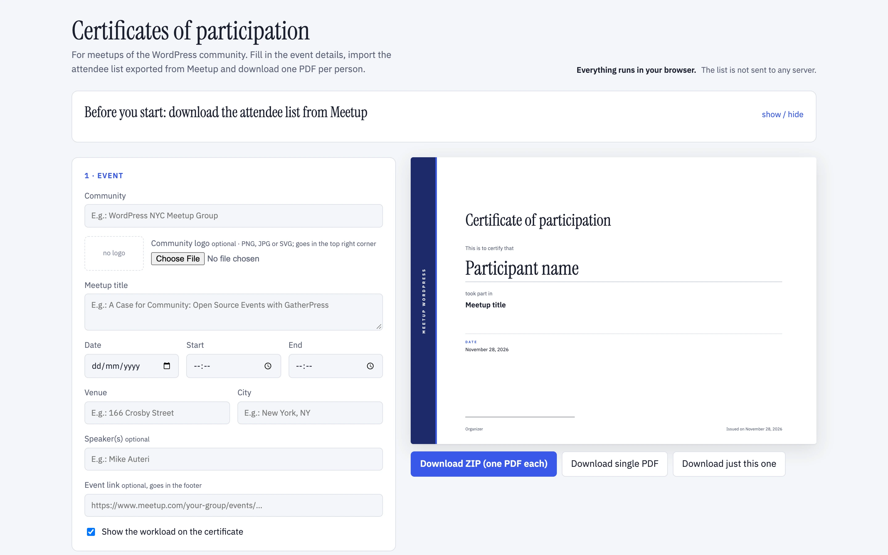

## The scenario

A WordPress meetup has forty people in the room and no one wants to make forty PDFs. The organizer puts one page on the site and tells everyone to open it.

## The steps

1. In **Standalone** the page **Certificates of participation** (`/certificate-generator/`) is made for you the first time an administrator opens the admin.
2. Fill in the event on the page, as in the Quick generator.
3. Share the address. Each attendee types their name and downloads their PDF; it is drawn **in their browser** with nothing sent to the site.
4. The organizer can also paste the whole list, or send the Meetup CSV ([Bring a Meetup list](../../guides/meetup-csv/)), and download one ZIP.

## What it does not do

The page **saves nothing**: no events, no records, and no code, so these certificates cannot be checked on the site. For records and checkable certificates use [the Generator](../course-with-classes/).
